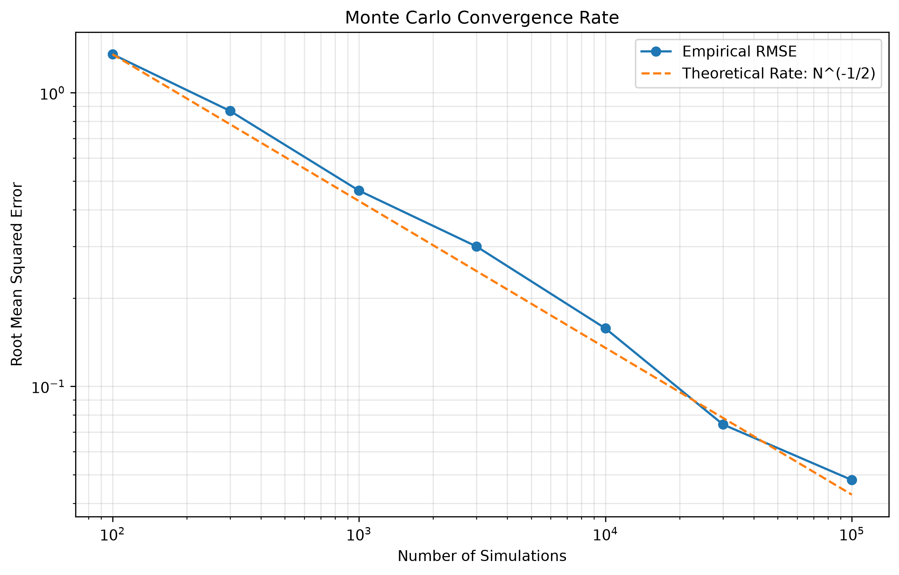
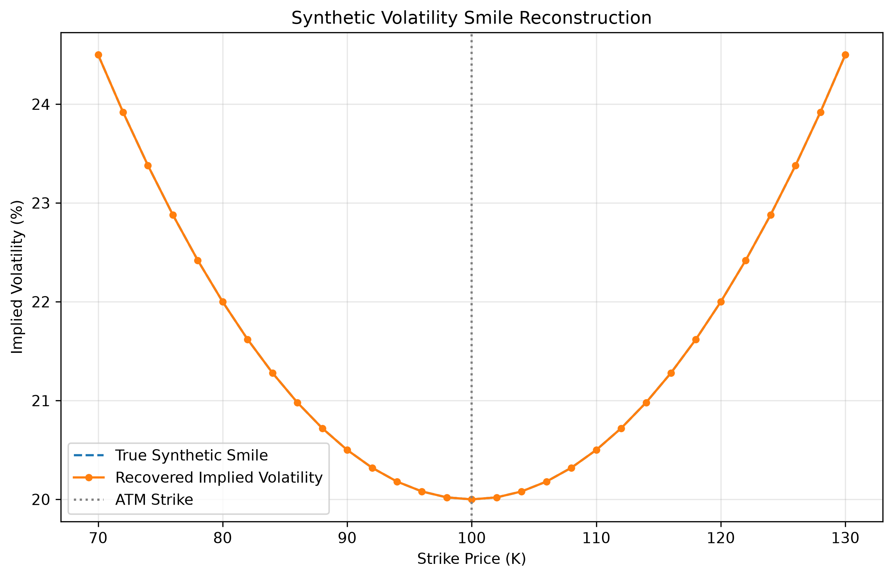
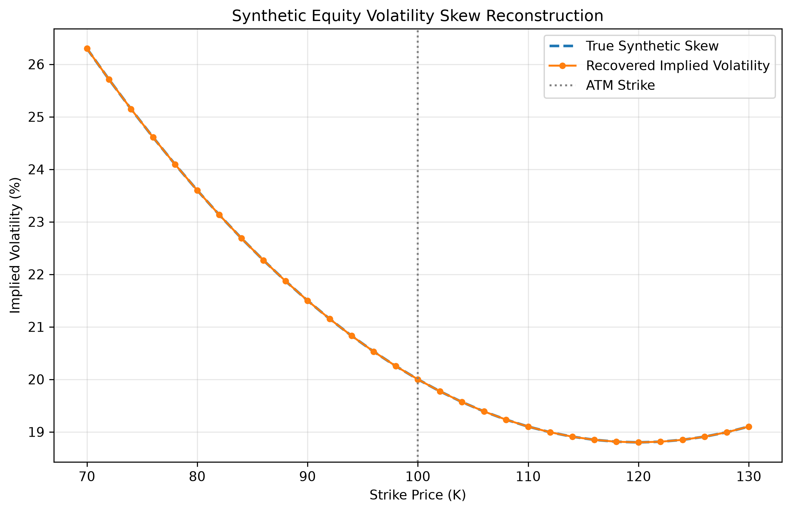
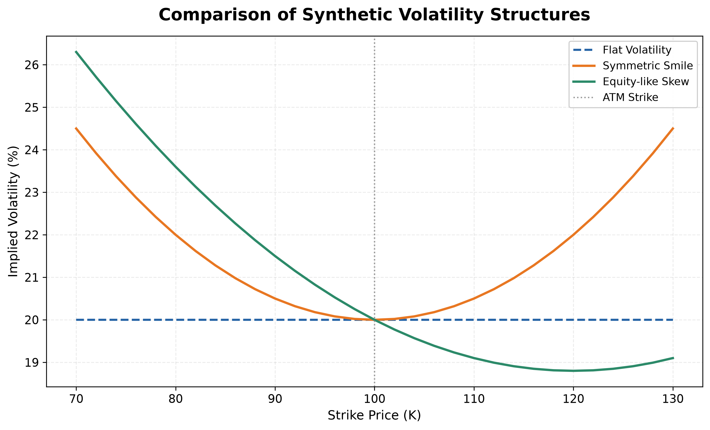

# Option Pricing and Volatility Modeling in Python

A quantitative finance project implementing European option pricing, Monte Carlo simulation, analytical and numerical Greeks, and implied volatility estimation.

The project combines mathematical modeling, numerical methods, and computational experiments to investigate option valuation under the Black-Scholes framework.

## 1. Project Overview

The project covers six main components:

1. Black-Scholes pricing and put-call parity.
2. Monte Carlo simulation and convergence analysis.
3. Analytical and numerical Greeks.
4. Implied volatility estimation using Brent and Newton-Raphson.
5. Synthetic volatility smile and skew analysis.
6. Black-76 pricing and empirical implied volatility analysis.

The implementation emphasizes numerical accuracy, reproducibility, and financial consistency.

## 2. Mathematical Framework

### Black-Scholes Model

European call and put options are priced using the Black-Scholes closed-form solutions.

The model assumes:
- Geometric Brownian Motion for the underlying.
- Constant volatility and risk-free interest rate.
- No dividends.
- Frictionless markets.
- European exercise.

### Monte Carlo Simulation

Terminal stock prices are simulated under the risk-neutral measure:

$$
S_T = S_0 \exp\left[
(r-\frac{1}{2}\sigma^2)T
+\sigma\sqrt{T}Z
\right]
$$

where $Z$ follows a standard normal distribution.

Option prices are estimated as discounted averages of simulated payoffs.

### Greeks

The project implements five sensitivities:

- Delta
- Gamma
- Vega
- Theta
- Rho

Analytical values are compared with numerical finite-difference approximations.

### Implied Volatility

Implied volatility is obtained by solving:

$$
BS(\sigma)-P_{\mathrm{market}}=0
$$

Two numerical root-finding methods are implemented:
- Brent's method
- Newton-Raphson using analytical Vega

### Black-76 Pricing and Implied Volatility

The project also implements the Black-76 model for
European options, using forward prices and discount factors.

For a European call:

$$
C = D(0,T)[F\Phi(d_1)-K\Phi(d_2)]
$$

where:

$$
d_1 = \frac{\ln(F/K)+\frac{1}{2}\sigma^2T}
{\sigma\sqrt{T}},
\qquad
d_2 = d_1-\sigma\sqrt{T}
$$

Implied volatility is recovered numerically using
Brent's root-finding algorithm.

The implementation includes:

- European call and put pricing.
- Put-call parity validation.
- Implied volatility inversion.
- No-arbitrage price bounds.
- Automated numerical and input validation tests.


## 3. Key Results

### Monte Carlo Convergence

Monte Carlo estimates converge toward analytical Black-Scholes prices.

An empirical convergence analysis using independent simulation replications produced a log-log RMSE slope of approximately -0.4968, consistent with the theoretical rate of -0.5.

### Greeks Validation

Analytical and numerical Greeks agree closely.

Finite-difference experiments illustrate the trade-off between truncation error and floating-point round-off error.

### Implied Volatility

Both Brent and Newton-Raphson successfully recover synthetic implied volatilities with high numerical accuracy.

Newton-Raphson exhibits sensitivity to the initial volatility guess, particularly in regions where Vega is small.

### Volatility Smile and Skew

Three synthetic volatility structures are investigated:

- Constant volatility
- Symmetric volatility smile
- Equity-like volatility skew

Implied volatilities are recovered from synthetic option prices.

Discrete monotonicity, convexity, and call-spread bounds are checked for the synthetic price grids.

### Empirical SPX Options Analysis

An additional empirical study investigates the implied
volatility structure of S&P 500 index options using
OptionMetrics IvyDB US data accessed through WRDS.

The analysis focuses on an option cross-section observed
on August 29, 2025.

**Data preparation**

- Filtering option quotes for liquidity and data quality.
- Separating AM-settled and PM-settled contracts.
- Matching European calls and puts by strike and maturity.
- Selecting out-of-the-money options for volatility analysis.

**Forward estimation and interest rates**

- Estimating forward prices using put-call parity.
- Examining sensitivity to the choice of near-ATM strikes.
- Incorporating the OptionMetrics zero-coupon yield curve.
- Comparing regression-implied discount factors with
  independently sourced interest rates.

**Implied volatility analysis**

- Constructing empirical volatility skews across maturities.
- Recovering implied volatility from market mid-prices
  using Black-76 and Brent's method.
- Comparing recovered volatilities with OptionMetrics estimates.
- Investigating systematic differences across moneyness
  and maturity.

**Robustness and key findings**

The observed volatility structure exhibits a negative
equity skew, with pronounced maturity dependence.

Forward estimates are relatively stable across alternative
near-ATM estimation windows.

Black-76 implied volatility estimates show relatively small
but systematic differences from OptionMetrics estimates.
These differences are investigated using alternative
discount factors and liquidity filters.

The empirical findings refer to a single observation date
and should not be interpreted as evidence of time-series
stability or predictive performance.

**Data availability**

The empirical notebook and underlying WRDS/OptionMetrics
data are maintained privately and are not included in
the public repository.

The publicly available code focuses on reusable pricing
models, numerical algorithms, and synthetic validation.


## 4. Selected Figures

### Monte Carlo Convergence



### Synthetic Volatility Smile



### Equity Volatility Skew



### Comparison of Volatility Structures



## 5. Repository Structure

The project is organized into reusable Python modules,
Jupyter notebooks, automated tests, and figures.

```text
quant-option-pricing/
│
├── src/
│   ├── black_scholes.py
│   ├── monte_carlo.py
│   ├── greeks.py
│   ├── implied_volatility.py
│   └── black76.py
│
├── notebooks/
│   ├── 01_black_scholes.ipynb
│   ├── 02_monte_carlo.ipynb
│   ├── 03_greeks.ipynb
│   └── 04_implied_volatility.ipynb
│
├── tests/
│   ├── test_black_scholes.py
│   ├── test_monte_carlo.py
│   ├── test_greeks.py
│   ├── test_implied_volatility.py
│   └── test_black76.py
│
├── figures/
│   ├── monte_carlo_convergence.png
│   ├── synthetic_volatility_smile.png
│   ├── synthetic_equity_skew.png
│   └── volatility_structures_comparison.png
│
├── requirements.txt
├── .gitignore
└── README.md
```

### Directory Description

- **src/**: Reusable implementations of option pricing
  models, numerical methods, Greeks, and implied volatility
  solvers.

- **notebooks/**: Computational experiments, numerical
  validation, and visualizations using synthetic data.

- **tests/**: Automated unit tests covering pricing
  accuracy, numerical consistency, volatility recovery,
  and input validation.

- **figures/**: Visualizations of Monte Carlo convergence
  and synthetic implied volatility structures.

### Private Empirical Analysis

An additional notebook, `05_market_data.ipynb`, contains
the empirical analysis of SPX options using OptionMetrics
IvyDB US data accessed through WRDS.

The empirical notebook and underlying market datasets
are maintained locally and excluded from version control.

The public repository remains reproducible without
access to proprietary market data.


## 6. Installation and Usage

Clone the repository and install dependencies:

```bash
pip install -r requirements.txt
```

Launch JupyterLab:

```bash
jupyter lab
```

Run the automated tests from the repository root:

```bash
python -m pytest tests/ -v
```

## 7. Testing

The project currently includes 70 automated tests:

- Black-Scholes pricing
- Put-call parity
- Monte Carlo simulation
- Greeks
- Implied volatility recovery
- Boundary conditions and input validation
- Black-76 pricing and put-call parity
- Black-76 implied volatility recovery
- Black-76 input validation and pricing bounds

## 8. Limitations and Future Extensions

The Black-Scholes framework assumes constant volatility, which is inconsistent with non-flat implied volatility structures observed in many markets.

Synthetic volatility smiles and skews are used to validate numerical recovery procedures; they are not calibrated market models.

The no-arbitrage checks performed on discrete strike grids do not establish global arbitrage-free pricing.

Future extensions include testing the empirical findings
across multiple observation dates, examining alternative
interest-rate and dividend conventions, and calibrating
a parametric implied volatility surface such as SVI.


## 9. Technologies

Python, NumPy, SciPy, pandas, matplotlib, pytest, and JupyterLab.
